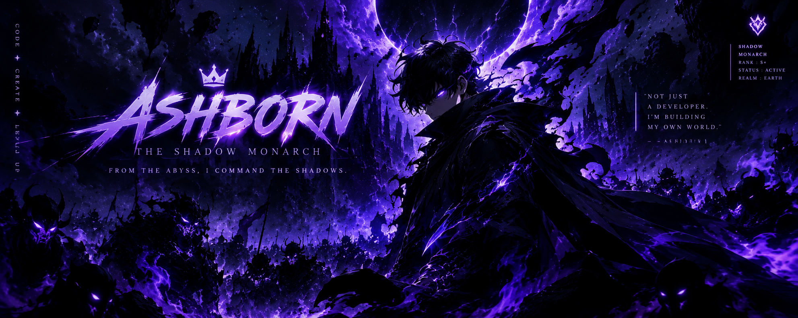

 

# Hi everyone :wave:

I'm a learner and love to create stuffs, lets hacking things together @ [OpenAI](https://openai.com).

  More stuff about me

## Quick overview

#### GitHub stats 
  

### What I do

I do Open Source. In fact, I do Open Source so much, that 95% of my work on
GitHub is free and open to everyone. I am really passionate about doing web
development, learn hacking - do hacking, create stuffs, it is in my opinion the best combination of logical programming and
(sometimes) beautiful design.

💜 INTERESTS
Gaming / Anime / Tech / Design / Problem Solving

## My skills 📜

### Web technologies

- JavaScript
- TypeScript
- Next.js
- Prisma
- HTML, CSS 
- SCSS
- Node.js 
- Deno
- WordPress
- PHP
- MySQL
- Microsoft Azure 

### Application Development

- Python 
- C++ (sort of)

### Productivity utilities

- Microsoft Office 
  [Excel]
  and
  [Word]
### Languages 🌐

| Language      | Proficiency                                                               |
| ------------- | ------------------------------------------------------------------------- |
| English       | A1                                                                        |
| Korean        | B1                                                                        |
| Spanish       | C2                                                                        |

## What I'm currently learning 📚

- Diving into VS Code's code base
- Typescript's magic
- Rust's blazing-fastness

## My own dictionary 📕:

| Word / abreviation | Meaning                                                | Note                                             |
| ------------------ | ------------------------------------------------------ | ------------------------------------------------ |
| FFWS               | Free Fire World Series                                 | I want to win that.                              |

